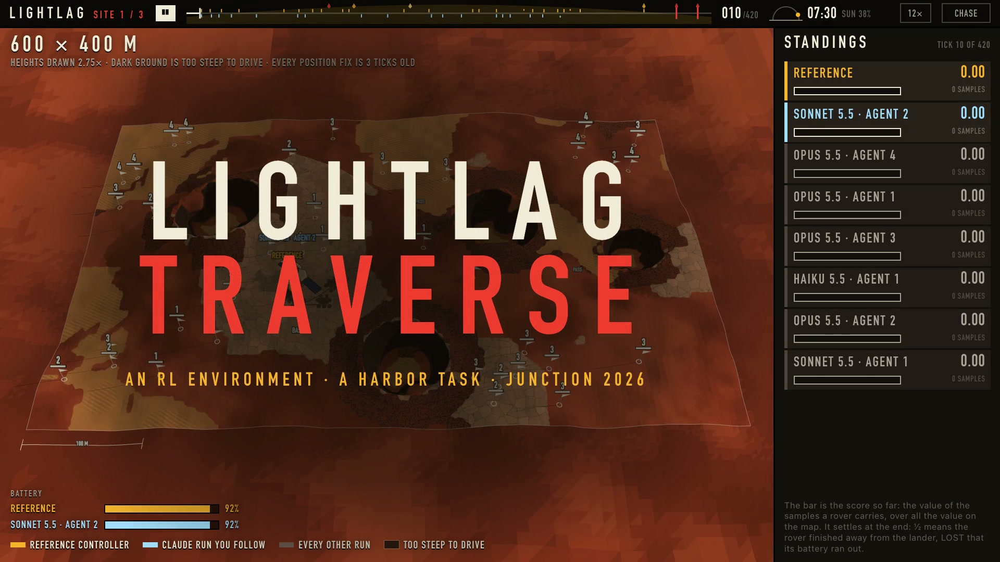

# Lightlag Traverse

**A Mars rover campaign where frontier agents lose to a planner.** Our entry for AfterQuery's *Break the Agent* challenge at Junction 2026.



One rover, three Mars-like sites in a row, a battery charged by the sun, and every command arriving three ticks late. Every rule and formula is public through five tools. A scripted planner scores **0.476**. Twenty-five agent runs by nine models from Anthropic, OpenAI and Google, each through OpenCode in Harbor, all score less. Most are far below, with an average of 0.23; Google's top model comes within 0.003 on its best run.

## Run it

You need Docker and [Harbor](https://docs.harborframework.com), 0.25.0 or 0.26.0 (`uvx --from harbor==0.25.0 harbor` runs it without installing).

**Get the task.** The whole repository is a download of more than a gigabyte, because every recorded run is saved with its replay. The task alone is 4 MB and arrives in seconds:

```sh
git clone --depth 1 --filter=blob:none --sparse https://github.com/solvisantos22/junction-2026
cd junction-2026
git sparse-checkout set harbor/lightlag-traverse-campaign
```

**Run it**, from the repository root:

```sh
harbor run -p harbor/lightlag-traverse-campaign -a oracle     # the reference: 0.476257, about two minutes
harbor run -p harbor/lightlag-traverse-campaign -a nop        # doing nothing: 0.000
harbor run -p harbor/lightlag-traverse-campaign -a opencode -m anthropic/claude-opus-5-5 --ak version=1.19.5 --env-file .env
```

**Your own agent or model.** Change `-a` and `-m`. Any Harbor agent that can use an MCP server can play; OpenCode is the one we ran. The task needs nothing of ours: no key, no account and no service beyond what your agent's model needs. The simulator runs in its own container beside the agent's, and the score is written when the agent's container has stopped.

Checked on Sunday 15 November from a fresh public clone made as above: the reference scored 0.476257 in 1 minute 50 seconds on Harbor 0.25.0, and the same on 0.26.0; doing nothing scored 0.000 in 21 seconds. The same morning an agent run with the third command and `-m openai/gpt-6.1-terra` scored 0.194 in nine minutes. The score is deterministic: the reference repeats it exactly on a laptop, on Modal and through Harbor.

The agent run needs a model key in `.env` (never committed). The runs below used OpenCode 1.19.5 and the task's 45-minute session. On a slow network add `--agent-setup-timeout-multiplier 3`, which lengthens only the install of OpenCode. Anthropic and OpenAI models need only their key. For a Gemini model, OpenCode 1.19.5 looks for the key under another name than the one Harbor passes, so add `--ak 'opencode_config={"provider":{"google":{"options":{"apiKey":"{env:GOOGLE_API_KEY}"}}}}'`; with it a Gemini 4 Hydrogen agent signs in and plays. Our own GPT and Gemini runs went through [`tools/tier_agents/run.sh`](tools/tier_agents/run.sh) in the full repository, which does the same. Harbor reports `NonZeroAgentExitCodeError` on OpenCode runs of this task because OpenCode exits with status 1 after an `EPIPE` at the end of its session; the reward is computed and recorded as usual.

## The task

The agent operates a rover through an MCP server with five tools: `rules`, `map`, `telemetry_log`, `uplink`, `advance` ([instruction](harbor/lightlag-traverse-campaign/instruction.md)).

- **Three missions** at three sites, each 420 ticks on 600 m by 400 m of ground with craters, a scarp, sand, rock fields and bedrock. About 38 targets are known at launch, most with deadlines, and 8 more appear on the way. Nobody can reach them all.
- **Light lag:** a command executes 4 ticks after it is sent, one per tick, and telemetry arrives 3 ticks old. Only `advance` moves the clock, so the agent can think as long as it likes.
- **The ground:** slip grows with slope and depends on the terrain, whose true slip is hidden inside a published range. Slopes over 0.36 stop the rover and wipe its queued commands. The heading has a hidden, drifting bias, and position fixes are noisy.
- **Power:** a battery of 100, charged by a sun that is low at the start and end of each mission. At 0 the rover is dead.
- **Score:** the value of the samples × (1 at the lander, ½ alive elsewhere, 0 if the battery ran out), summed over the three missions and divided by all the value there was.

Every formula and number is in `rules()`. The practical way to play is to write an autopilot, so that is what the task measures: can the agent write a mission program that works, with no reset and no practice run.

## Results

| Driver | Runs | Campaign score of each run | Mean | Sites where the rover was lost or left away |
|---|---:|---|---:|---:|
| **Reference planner** (scripted, no model) | | **0.476** | **0.476** | 0 of 3 |
| Gemini 4 Carbon | 3 | 0.473, 0.449, 0.000 | 0.307 | 0 of 9 |
| Gemini 4 Hydrogen | 3 | 0.442, 0.404, 0.261 | 0.369 | 2 of 9 |
| GPT-6.1 Sol | 3 | 0.379, 0.353, 0.350 | 0.361 | 3 of 9 |
| Gemini 4 Argon | 3 | 0.297, 0.000, 0.000 | 0.099 | 1 of 9 |
| Claude Sonnet 5.5 | 2 | 0.293, 0.213 | 0.253 | 2 of 6 |
| GPT-6.1 Terra | 3 | 0.291, 0.229, 0.214 | 0.245 | 0 of 9 |
| Claude Opus 5.5 | 4 | 0.267, 0.247, 0.244, 0.120 | 0.220 | 3 of 12 |
| GPT-6 Luna | 3 | 0.198, 0.110, 0.025 | 0.111 | 2 of 9 |
| Claude Haiku 5.5 | 1 | 0.000 | 0.000 | sent no command |
| The reference, stopped after the first site | | 0.149 | | |
| Doing nothing | | 0.000 | | |

Sorted by each model's best run. The models are off the shelf, not fine-tuned. The three Gemini runs at 0.000 ran out their 45-minute session before the rover had sampled anything.

No run beats the reference at any single site either. Two Gemini 4 Carbon runs tie it at the third site with the same raw score; elsewhere the closest are 0.457 against 0.459 and 0.502 against 0.508. Per-site scores and what each Claude run did are in the [campaign write-up](docs/lightlag-traverse-campaign.md); the GPT and Gemini runs are in [Manh's comparison](docs/tier-comparison.md) and its [ledger](docs/tier-comparison/runs.jsonl), as of Sunday 05:45. Every run's trajectory and the simulator's replay are under [`docs/lightlag-runs/`](docs/lightlag-runs/) as `campaign-*`.

**Not three lucky worlds.** The programs the models wrote were replayed on Modal on 300 worlds none of them had seen: 22 programs from all nine models, six by Claude and sixteen by GPT and Gemini. The reference scored higher in 6,390 of 6,600 match-ups and lost no rover. Taking only each model's best program, which favours the models, it scored higher in 2,556 of 2,700: 95 times in 100, the figure in the film ([Claude's programs](docs/traverse-farm.md), [GPT's and Gemini's](docs/tier-comparison.md), [how the count is made](docs/manh-demo/README.md)).

The best of them get closer, and still fall short on ground they had not seen. The reference averages 0.502 there. The two best programs, written by a Gemini 4 Hydrogen agent and a GPT-6.1 Sol agent, average 0.454 and 0.446 and win about one world in six. The Gemini 4 Carbon program that scored 0.567 on its own world averages 0.410 ([tables](docs/tier-comparison/tables.md)).

## Why the agents lose

Read from the Claude runs' trajectories, replays and own reports:

1. **Worse routes.** The runs that came home at every site still took 28 to 53% fewer samples than the reference. A textbook controller (terrain search, a Kalman filter, the nearest worthwhile target next) scores 0.270 on the same three sites, about what Claude scores. The reference's edge is planning the whole day: which targets, in what order, against deadlines, the clock and a forecast of battery and sun.
2. **Flat batteries with home in reach.** Three of the six Opus and Sonnet runs ran a battery flat, one of them 13 m from the lander with 21 samples on board. On 300 fresh worlds, 87% of the Claude rovers that were lost ran flat while the way home was still open. Under these rules the sun always out-charges the idle drain, so stopping to wait would have saved every one of them.
3. **Write once, look later.** The agents' autopilots played a whole site in 8 to 30 seconds of real time. Three agents' own reports say the damage was done before they had looked.

The GPT and Gemini runs have been scored but not yet read as closely. What shows so far:

- **Gemini 4 Carbon is the one model that nearly matches the reference, when it finishes.** In its best run it wrote a path-finder in C, an estimator, a planner and its own simulator, and tested the autopilot there before it started the mission. It came home everywhere with 22, 26 and 20 samples against the reference's 23, 26 and 19; at the second site they are the same 26 targets. In one run of three its session ran out before the rover had sampled anything.
- **GPT-6.1 Sol** came home at the second and third sites with scores near the reference's, and ended the first site away from the lander in all three runs, for half credit.
- **Gemini 4 Hydrogen**, Google's smallest, came home everywhere in two of three runs with 18 to 24 samples a site.

## The reference

The reference is a planner, not a model: [`lightlag_traverse/pilot.py`](lightlag_traverse/pilot.py). It plays through the same five tools and sees nothing an agent does not. It tracks the rover through the delay with a filter, learns how each surface slips from its own odometry, and searches for a route whose every leg the battery can pay for against the sun, ending at the lander.

It is hard to improve. Of fourteen changes to its parts, the best combination gained 0.001 on fresh worlds, with an interval that spans zero ([ablations](docs/reference-ablation-results/README.md)). We also tried to beat it with learning. An Extra Trees model trained on Modal to pick among twelve planner strategies mid-mission gained 0.48 points on 96 fresh worlds (95% interval 0.27 to 0.72), under the 1 point we had set as the bar, so the reference stayed as it was ([learned planner](docs/learned-portfolio-results/README.md)). A second round, with sixteen strategies and four model families over 8,192 missions, found the same. On 192 more fresh worlds the Extra Trees model gained 0.28 (interval −0.07 to 0.52), a new Random Forest 0.20 (0.10 to 0.30) and the best fixed strategy 0.35 ([planner lab](docs/planner-lab-results/README.md)).

## Reward integrity

- **Doing nothing scores 0. Stopping after the first site scores 0.149**, under a third of the full run. A flat battery scores 0 for that site and ending away from the lander halves it, so dying or walking away is never the best move.
- **The score comes from the rover's true state.** The simulator computes it in its own container after the agent's container has stopped, and a fresh verifier container reads that file and nothing else.
- **We attacked it first.** A probe agent ran 27 attacks from inside the agent's container: searching it for seeds and tokens, 1,147 ports, guessed routes, hidden tools, 36 malformed commands, the delay, twelve sessions at once, and forged reward, result and grader files. None changed the reward or disclosed a hidden value ([what was tried and what held](docs/traverse-integrity.md)).
- **One known limit.** The worlds are fixed by their seeds, and the seeds and the simulator's code are in this repository, so whoever holds the repository can predict a mission. The agent's container holds neither. To take it off the table, change `LIGHTLAG_SEEDS` in [`docker-compose.yaml`](harbor/lightlag-traverse-campaign/environment/docker-compose.yaml) to any integers: the reference averages 0.502 on 300 worlds it had never seen.

## A smaller model that learns

Sölvi trained small controllers on Modal that choose the next goal above a fixed, hand-written navigation layer ([results](docs/learning-final-results/README.md)). Scores are the share of all value brought home.

| Controller | 40 fresh worlds | The campaign |
|---|---:|---:|
| Before training | 8.3% | 8.0% |
| PPO, trained (mean of three seeds) | 35.9% | 36.6% |
| Replay learner, trained (mean of three seeds) | 36.3% | 33.4% |
| A greedy rule on the same navigation | 38.0% | 36.7% |
| Reference planner | 50.8% | 47.6% |

On the campaign every trained seed scored above every recorded Claude run (best 29.3%), and the reference stayed ahead of them all. This is a small controller on a hand-written scaffold, not a fine-tuned language model. PPO lost three of 120 rovers on the fresh worlds, and neither learner beats the greedy rule. Training took 47,840 missions and an estimated $7.26 of Modal compute. A second learner, Manh's PPO choosing targets above the reference's own steering, reached 38.0% on 300 fresh worlds and 0.375 on the campaign ([write-up](lightlag_ppo_icm/README.md)).

A separate frozen composition test combined all six retained policies with a greedy shortlist. On **256 new matched worlds**, the hybrid scored **39.31%** versus greedy **38.40%**, with all **2560 evaluation missions home and alive**. The paired gain was **+0.907 percentage points** (95% interval **+0.323 to +1.518**): a small positive gain, below the predeclared 1-point target. The reference scored **51.27%** on these same worlds and remains unchanged. [Full final results and figure](docs/learning-hybrid-results/final/completed/README.md) · [Copy-ready submission text](docs/learning-hybrid-results/final/submission-copy.md). No new training or tuning followed this final test.

## See it

- **Live on Modal:** [kristjansolvi03--lightlag-traverse-live-web.us-east.modal.run](https://kristjansolvi03--lightlag-traverse-live-web.us-east.modal.run). Pick any world; Modal drives eight rovers on it (the reference, a textbook controller and six Claude-written autopilots) and plays the replay. A new world takes about a minute.
- **The judged runs, replayed:** open [`viewer/traverse-campaign.html`](viewer/traverse-campaign.html) from a clone, one file with no server. Keys 1 to 3 pick the site, S starts the story of what went wrong, N skips to the next moment.
- **Video:** [watch the final submission video on YouTube](https://youtu.be/GifcHfCczHo) (**1:59**, public; [upload and saved-link verification](docs/video-upload.md)). The uploaded file is [`docs/submission-video/lightlag-traverse-submission.mp4`](docs/submission-video/lightlag-traverse-submission.mp4), named final by Manh at 07:45 Sunday; [media notes](docs/submission-video/README.md). The earlier cut, with the [source of every number in it](docs/demo-video/README.md): [`docs/demo-video/lightlag-traverse-demo.mp4`](docs/demo-video/lightlag-traverse-demo.mp4).
- **Deck:** [`docs/pitch-deck/lightlag-traverse-deck.pdf`](docs/pitch-deck/lightlag-traverse-deck.pdf), eleven slides, with a [talk track](docs/pitch-deck/README.md).

## What Modal did

Modal ran the rollout farm (about 6,000 missions by Saturday evening, the 300-world comparisons in minutes on up to 100 containers, with model-written programs isolated from our machines), the training runs above, and the live demo. The farm turned "the reference wins on one world" into the 6,600 match-ups, and found the 87%. Commands, app IDs and spend are in [`docs/traverse-farm.md`](docs/traverse-farm.md) and [`docs/prize-evidence.md`](docs/prize-evidence.md).

## Where things are

| Folder | What |
|---|---|
| [`harbor/lightlag-traverse-campaign/`](harbor/lightlag-traverse-campaign/) | The task: instruction, environment, tests, solution |
| [`harbor/lightlag-traverse/`](harbor/lightlag-traverse/) | The same rules on one site (world 2026), as a fallback: reference 0.565; of 26 agent runs one is above it, Gemini 4 Carbon at 0.567 |
| [`lightlag_traverse/`](lightlag_traverse/README.md) | The simulator and the reference; 75 tests in `tests/lightlag_traverse/` |
| [`docs/lightlag-runs/`](docs/lightlag-runs/) | Every recorded run |
| [`tools/traverse_farm/`](tools/traverse_farm/) | The rollout farm and the live site on Modal |
| [`tools/traverse_integrity/`](tools/traverse_integrity/) | The integrity probes |
| [`viewer/`](viewer/) | The demo pages |

## Caveats

- **The top Gemini model nearly closes the gap.** Gemini 4 Carbon's best campaign run is 0.003 below the reference (0.473 against 0.476), and on one site alone one of its runs is above it (0.567 against 0.565). It also scored zero in one campaign run of three, when its session ran out. For the other eight models the best run is 0.03 to 0.48 below.
- **When the reference was built.** It was improved (0.448 to 0.565 on world 2026) after two early agent runs had beaten its first version there. The campaign's worlds and the 300 fresh worlds were played afterwards, and nothing was tuned on them.
- **Replays measure programs.** The fresh-world comparison replays saved programs without the agents that wrote them.
- **Run counts are small.** One to four runs a model; enough to see the spread, not to state a rate. The table is as of Sunday 05:45.

## The team

Kristján, Sölvi and Manh, with Claude Code and Codex. Everything we tried and retired on the way, including the earlier Lightlag environments, is written up under [`docs/`](docs/).

Codex helped implement and review the early evaluator, learning controllers and experiment orchestration, including the frozen evaluations and reproducible reports. The [Codex and Modal prize case](docs/sponsor-submission.md) links concrete contributions, human decisions, app IDs and the live demo to the [full evidence log](docs/prize-evidence.md); final Traverse simulator/reference and Claude Code contributions are credited separately.

Working in this repository: read [AGENTS.md](AGENTS.md) and [TEAM_STATUS.md](TEAM_STATUS.md) first, and follow the [junction-team-workflow](.agents/skills/junction-team-workflow/SKILL.md) skill. Other entry points: the first [Lightlag prototype](lightlag/README.md) and its [handoff](docs/lightlag-handoff.md), [Lightlag Live](docs/lightlag-live.md), [AfterQuery readiness](docs/afterquery-readiness.md), [AfterQuery ideas](afterquery-ideas.md) and [research](docs/research/README.md), [sponsor tools](SPONSOR_OPTIONS.md), [Junction Watch](tools/junction_watch/README.md).
