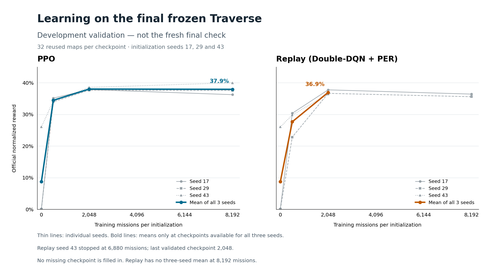

# Final Traverse learning results and handoff

**Every latest trained controller beats all recorded Opus/Sonnet attempts on the exact submission campaign. Learning also transfers to 40 fresh worlds. Neither method demonstrates an advantage over greedy, and the existing reference remains stronger. Keep the reference.**

All six runs are accounted for. Five completed 8192 training missions; replay seed 43 stopped at the deadline after 6880 and retains its last declared checkpoint at 2048. Neither method qualified for continuation. Training, the supervisor, progress publisher and one-time completion wake-up have finished. No training was repeated or old campaign resumed.

## Exact campaign: the comparison with Opus

The same frozen policies played worlds **2027, 2028, 2029**, with the same weighted score as the recorded LLM attempts.

| System | Campaign reward | Range across seeds / attempts |
|---|---:|---:|
| Initial controller, each method | 8.01% | 0.00–24.02% |
| Latest PPO, mean of 3 seeds | **36.64%** | 34.01–39.53% |
| Latest replay, mean of 3 seeds | **33.36%** | 32.61–34.36% |
| Greedy, same navigator | 36.73% | — |
| Frozen reference | 47.63% | — |
| Recorded Opus, 4 attempts | 21.98% | 12.01–26.75% |
| Recorded Sonnet, 2 attempts | 25.28% | 21.30–29.26% |

The weakest latest trained seed scores 32.61%, above the best recorded Opus and Sonnet attempts. All 19 evaluated policies/controls finish all three missions alive at home: **57/57 audited missions**, zero invalid calls. The reference reproduces its recorded score exactly, mission by mission. [Full campaign evidence, every seed and matched-2048 results](campaign/README.md).

This compares hybrid trained controllers with historical LLM agents, with different training/compute budgets. Navigation and feasibility logic are hand-written. All six recorded Opus/Sonnet attempts completed the campaign but retained EPIPE/nonzero-exit errors; Haiku's length-censored zero is excluded from the table. It is a fixed showcase, not proof of general LLM superiority or LLM post-training. No new model API or Harbor run was made here.

## Fresh worlds: does learning transfer?

| System | Mean reward on 82000–82039 | Alive at home / missions |
|---|---:|---:|
| Initial controller, each method | 8.27% | 120/120 |
| Latest PPO | 35.92% | **117/120** |
| Latest replay | 36.29% | 120/120 |
| Greedy | 37.99% | 40/40 |
| Frozen reference | 50.82% | 40/40 |

Latest PPO improves by 27.66 percentage points over initialization (paired 95% interval +25.14 to +29.83); replay improves by 28.03 points (+26.66 to +29.46). Neither demonstrates an advantage over greedy; both remain below beam. PPO at 2048 scores 36.78% with one death, versus 35.92% with three deaths at 8192. Replay at 2048 scores 35.02%; its latest row uses budgets **8192, 8192, 2048**. These intervals resample maps, conditional on the three training initializations. No seed or checkpoint was selected by score.

All **760 unique cases** pass the retained physics/score/choice audit. [Full tables, intervals and limitations](evaluation/README.md). All three latest PPO deaths occur on 82001; a fourth death affects PPO29 at 2048 on 82024. [Saved-trace diagnosis](evaluation/failure-notes.json) places the losses on the home leg after battery depletion despite feasible saved home forecasts. That motivates later investigation on development maps; no cause is proven and no policy was changed after evaluation.

## Figure and copy for the submission

[1920×1080 PNG](figures/learning-curve.png) · [Vector SVG](figures/learning-curve.svg) · [Data/provenance](figures/learning-curve-data.json) · [README/video paragraph and caption](submission-copy.md).

The curve is **development validation on reused worlds 81000–81031**, not the fresh comparison or campaign. Replay has no all-seed 8192 point because its third run missed that checkpoint. Do not overlay fresh-world reference scores as if matched to this curve.

## Compute, source and verification

- **Training:** 47,840 missions / 1495 batches in six original Modal calls. [Terminal evidence, 52 downloaded artifacts and reconciliation](fit/README.md). All 736 retained development validation missions were reported home/alive with no invalid calls; that did not guarantee fresh-map safety.
- **Cost:** **$7.262395867** estimated running CPU/memory for this final fit, excluding startup/build/storage/egress and other experiments; not an invoice or balance. [Modal app `ap-GGkMI4eQi8N9MVVuTef5Au`](https://modal.com/apps/solvisantos22/main/ap-GGkMI4eQi8N9MVVuTef5Au). The old pilot's separately reported estimate was $1.592405 on its original navigator. Final evaluation used local CPU, with no new cloud jobs, GPUs or model API calls.
- **Freeze:** training/evaluator source `becbf3e`, Python 3.12.16 / NumPy 2.3.4 / Torch 2.9.1. [Source/resource freeze](freeze.json) published in `2257871`; [all-seed policies](policy-freeze.json) published in **`d81fa88` before final worlds**; [campaign source/weight freeze](campaign/freeze.json) published in **`48a63ee` before campaign worlds**. No frozen source was edited.
- **Checks:** 760 fresh cases and 57 campaign missions audited; independent artifact/statistics review; six campaign tests, three aggregation tests and two plotting tests. Final campaign parent-hash hardening passed both metadata tests. The figure was visually checked and regenerated deterministically. Earlier new-run preflight had 51 focused tests. Historical `lightlag_rl` fixtures retain their original pins; this is not a claim that every historical test passes against changed main.
- **Audit scope:** physics, scores, recorded policy choices and summaries are reconstructed. Observation generation, controller linkage and beam planning remain source-pinned. Production optimizer learning is not reconstructed; batch/replay/optimizer archives remain on Modal volume `junction-learning-final`.
- **Attribution:** Sölvi chose the experiment, budget and matched-campaign comparison. Codex implemented and audited learners, orchestration and reports. Simulator/navigation and feasibility helpers retain the team's original authorship. [Prize evidence](../prize-evidence.md) records contributions and compute.

## Decisions and handoff

1. **Keep the frozen reference and task.** The trained controllers meet the requested recorded-LLM comparison bar but do not improve on the reference; greedy must remain visible alongside learning.
2. **Use the learning result as supporting submission evidence.** The task/demo owner can reuse the paragraph and figure. Retain the hand-written-navigation, agent-exit, incomplete-budget and fresh-PPO-death limitations.
3. **Do not extend this run or retune on final worlds.** **82000–82039 are now consumed.** Future work needs a separate bounded protocol and fresh evaluation range; preserve every artifact here.
4. **Teammates' work continues independently.** Manh's target learner/Gemini attempts and Kristján's learned-planner experiment have separate scopes and seeds. This result neither changes their jobs nor promotes a reference replacement.

## Follow-up question: combining RL and greedy

Greedy ranks feasible targets by expected credited science divided by estimated visit time (including the charging forecast), and goes home if none qualifies. It uses the same navigator and feasibility interface as the learned policies. A possible new experiment is to let greedy supply a shortlist of similarly efficient targets and let RL select within it; its shortlist rule must be fixed using development data before another fresh check.

A [saved-development-trace diagnostic](fit/development-overlap.json) covers 192 episodes and 3736 recorded decisions. Excluding forced home-only decisions, PPO agrees with greedy on 68.1% and replay on 70.7%. Their choices therefore differ often enough to investigate, but disagreement does not show complementary strengths or an ensemble improvement. These are states visited by the learned policies, not counterfactual outcomes. No hybrid was built, no new map was opened, and the completed experiment was not changed. Coordinate any follow-up with the separately claimed learned-planner work rather than duplicate it.

[Evaluation plan](evaluation-plan.md) · [Historical monitoring/recovery notes](monitoring-history.md) · [Original training protocol](../learning-final.md). No supervisor or completion watcher needs rearming for this completed experiment.
