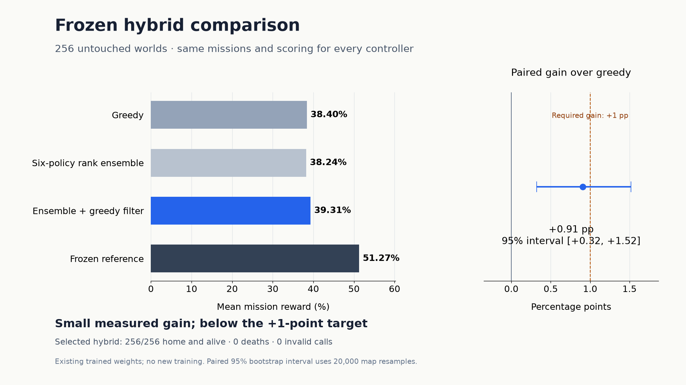

# Final hybrid result: a small gain, below the upgrade target

On **256 untouched worlds**, the frozen RL–greedy hybrid scores **39.31%**,
versus **38.40% for greedy**. Its paired gain is **+0.907 percentage points**,
with a 95% map-bootstrap interval of **+0.323 to +1.518 points**. Every final
mission returned home alive. The gain is positive, but narrowly below the
predeclared **1-point minimum**, so the registered primary success gate is
**false**. The frozen reference remains substantially stronger at **51.27%**.

**This experiment is closed. No further training, search, tuning or extension.**
Sölvi requested submission preparation after this result. Keep the current
reference and task; use the figure and copy below as supporting evidence.

[1920×1080 PNG](figures/comparison.png) · [Vector SVG](figures/comparison.svg) ·
[Figure data/provenance](figures/comparison-data.json) ·
[Copy-ready README/video text](../submission-copy.md).

## Same worlds, all controls retained

| Controller/group | Mean reward | Joint home/alive | Deaths |
|---|---:|---:|---:|
| **Selected six-policy ensemble + greedy filter** | **39.3109%** | **256/256** | **0** |
| Greedy, same navigator | 38.4037% | 256/256 | 0 |
| Pure six-policy rank ensemble | 38.2397% | 256/256 | 0 |
| Pure PPO, mean of all 3 seeds | 38.0994% | 768/768 | 0 |
| Pure replay, mean of all 3 seeds | 36.7376% | 768/768 | 0 |
| Frozen beam reference | 51.2727% | 256/256 | 0 |

The selected group is **`ensemble-all-rho090`**: all six retained policies rank
the legal actions; their percentile ranks are averaged; science choices must
have at least 90% of the best feasible greedy efficiency. Home stays legal.
This combines existing learned weights with hand-written navigation and
feasibility logic. It is **policy composition, not a new training result**.

PPO seeds 17/29/43 and replay seeds 17/29 retain their 8192-mission policies;
replay seed 43 retains its previously declared 2048-mission role. No seed or
checkpoint was selected by final score. Single-policy group statistics average
all three training seeds within a world before averaging worlds. No per-world
oracle switching is used.

[All six group summaries and paired intervals](analysis.json) ·
[Group CSV](group-summary.csv) · [All ten individual arm summaries](arm-summary.csv).
All ten arms used exactly worlds **612000–612255**, giving **2560 cases**.
All 2560 were jointly home and alive, with zero away endings, deaths or invalid
calls. Earlier development/confirmation deaths and infrastructure failures
remain in their original reports; this clean final stage does not erase them.

## Registered decision and limits

| Predeclared final requirement | Observed | Outcome |
|---|---|---|
| Mean gain over greedy at least 0.01 | 0.009072611 | **Fails** |
| Paired 95% lower bound above zero | 0.003230022 | Passes |
| No deaths/errors/invalid calls | Zero | Passes |
| Joint home/alive rate ≥ greedy − 1/256 | 1.0 versus 1.0 | Passes |

The sole failing condition is the minimum effect size. Report the small
positive gain and the missed target together; do not round 0.907 points up to
the required 1 point or claim reference-level performance. The selected hybrid
is 11.962 points below the reference on these same worlds.

The interval uses the original 20,000 paired map resamples with seed 612256.
It is conditional on these retained policies and the selection made before
the final test; it does not measure variability from retraining new seeds.
Development and confirmation were selection data. The final primary group,
controls, weights and source were published in **`67a9203f` before opening
this final range**. There is no further selection on these results. This test
does not establish a comparison against LLM agents on other worlds or harnesses.

## Verification and retained artifacts

The original final app is **`ap-GzqnjGbRi4h0x0SqO4xiQW`**, coordinator call
**`fc-01M7EHYJ7272Q4Z5432990CT78`**. It completed all 2560 cases at
**15 November 03:16:21 UTC**. [Original receipt](../receipt.json),
[frozen matrix](../stage.json), [source/resource/lineage freeze](../ops-freeze.json).

- [Full terminal rows/call IDs/trajectory hashes](state.json), SHA256
  `feb331aed9bd96522b72e233f7f260083c132f4620d27ef84766d95a3babf972`.
- [Independent terminal/source/lineage/cost audit](terminal-audit.json) verifies
  the exact original call, all protected sources/weights and 20 unchanged
  parent failure/recovery/confirmation records.
- [Independent statistical audit](independent-audit.json) exactly reproduces
  every group mean, map vector, paired interval, safety count and final gate.
- [Full decoded archive audit](artifact-audit.json) checks all **10,245 manifest
  files**, 2560 compressed/canonical cases, raw and mapped worker rows, saved
  receipts, job/source/policy identities and official score arithmetic.
  The cases retain **1,008,687 replay commands** and **386,776,218 compressed
  case bytes**. No new mission or controller run was needed for this local audit.
- Every original final worker retained a successful physics audit and a full
  controller repeat: **2560 of each**. All 2304 non-beam cases also have a
  hybrid-choice audit. Local content checks bind these recorded remote audits
  to the exact case bytes; they do not pretend to repeat controller execution
  again locally or reconstruct training gradients.

All final metadata and cases were downloaded once using the existing parallel
Modal CLI and the [reviewed cache adapter](../download-from-cache.py), then
verified by the unchanged frozen downloader. [Transport verification](cache-verification.json)
and [original download manifest](download-manifest.json) are retained. Paths
in the latter refer to the private verified archive, not this public directory.
The archive is `/tmp/junction-hybrid-final-verified-20261115`; its source cache
is `/tmp/junction-hybrid-final-cache-20261115`. All compressed cases, including
every selected-policy trajectory and both matched baselines, also remain on
Modal volume `junction-learning-hybrid`, under the paths recorded in the rows.
Do not redownload or repeat completed jobs automatically.

[Published-file hashes](files.json) cover this report's files. Frozen training,
all parent weights, prior failures and the current reference are unchanged.
The incomplete greedy-prior experiment stays closed; its 629000–629127 worlds
were never opened.

## Reproduce saved statistics and figure without running missions

The [frozen analysis source bundle](frozen-analysis-source.zip) contains exactly
59 hash-checked source/policy/master files and their manifest, with no secrets.
It makes the original code available independently of later teammate changes
on main. Use Python 3.12 with NumPy 2.3.4 and Torch 2.9.1. Extract into a fresh
directory, then run the bundled `tools.learning_hybrid.experiment analyze`
with the published `../stage.json` and `state.json` paths and a new output.
The result must hash to
`116a673e680ca6155733599412a2893c3d2ba6767dbab655210bcb161db3a349`.
This recomputes saved statistics only; it neither opens worlds nor launches
Modal work. [Bundle reproduction check](reproduction-check.json).

Render the figure with Matplotlib using
`python figures/generate.py --analysis analysis.json --output NEW_FIGURE_DIRECTORY`.
The PNG was visually inspected for labels, scale, interval and target display.

## Cost and submission handoff

Final-stage recorded running compute is **$2.210225**: workers **$2.136982**,
coordinator **$0.073243**. Cumulative hybrid, including smoke, all stages and
earlier attempts/coordinators, is **$6.347080**. Separate closed greedy-prior
training is **$2.404367**, for a combined **$8.751447** in this follow-up wave.
These are CPU/memory running estimates, excluding ancillary, idle and lost
unrecorded work; they are not invoices or credit balances. The earlier original
training campaign has its own separate cost report. No model API calls or GPUs
were used for this composition experiment.

Use the [short paragraph and caption](../submission-copy.md) with the figure.
The [original before/after learning result](../../../learning-final-results/README.md)
and its existing learning curve remain a separate training result on different
matched maps; do not merge those scores into this table. Final submission/video
owners can integrate the supplied assets. The final comparison is linked from
the repository README. No additional experiment or reference promotion follows.
