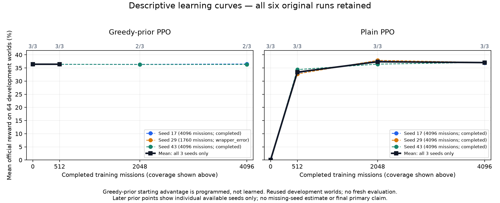

# Greedy-prior PPO training

**Closed as an incomplete primary comparison:** five original runs completed 4096 missions, while `prior-29` stopped at 1760. All six terminal calls and retained milestones are reconciled. The published all-six gate fails, so fresh worlds **629000–629127 remain unopened**. No run was resumed or replaced. Source and resources were published before launch.
## Final descriptive findings

On the same repeatedly used 64 development worlds, the three plain-PPO seeds
improve from **0.000000 to 0.370550** after 4096 training missions. Their
zero-head initial deterministic policy chooses home; this is the stated
initialization, not a representative pretrained-model baseline. Initial prior
policies are exactly greedy, scoring **0.363980**. The plain final mean is
0.006570 higher on these development data; no fresh-world or significance claim
is made. The two completed prior seeds finish at **0.365150** and **0.363492**.
There is **no three-seed prior mean after 512**, because seed 29 is missing.

| Original run | Terminal state | Training missions | Initial | At 512 | At 2048 | At 4096 |
|---|---|---:|---:|---:|---:|---:|
| prior-17 | completed | 4096 | 0.363980 | 0.363980 | 0.363718 | 0.365150 |
| prior-29 | wrapper_error | 1760 | 0.363980 | 0.363980 | — | — |
| prior-43 | completed | 4096 | 0.363980 | 0.363980 | 0.363291 | 0.363492 |
| plain-17 | completed | 4096 | 0.000000 | 0.331265 | 0.377478 | 0.369297 |
| plain-29 | completed | 4096 | 0.000000 | 0.327461 | 0.379025 | 0.371018 |
| plain-43 | completed | 4096 | 0.000000 | 0.343901 | 0.364665 | 0.371333 |



[Audited report](descriptive/report.json) · [SVG figure](descriptive/learning-curves.svg) ·
[artifact hashes](descriptive/artifacts.json) · [all retained policies/checkpoints and archive locations](archive-manifest.json).

Independent review also reproduced all 22 development summaries from the
retained episodes and checked the terminal download hashes. All
**22 checkpoint/validation pairs** verify, covering **1408 development
missions**, all home/alive with zero invalid calls. The audit verifies
source/receipt identities, file hashes, optimizer/RNG restoration, exported
policy equality, initial behavior and official reward/summary arithmetic. It
does not re-execute production gradients or mission physics. The actual PNG
was visually checked; a shared-axis clipping issue was corrected and covered
by a regression test. Six reporter tests pass.

The runs retain **22,240 training missions**. Their batch summaries record
**59 deaths, 58 away endings and zero invalid calls**; the overlap of deaths
and away endings was not reconstructed. These training outcomes are separate
from the clean development validation outcomes. The six returned wrappers sum
to **$2.40437 estimated running CPU/memory**, excluding ancillary costs; this
is not an invoice. App **`ap-59QwuUBGJ18ZztGfLBhd9u`** and all original call IDs
remain in [the receipt](receipt.json).

The repository retains all 22 declared policies and optimizer checkpoints, six
trainer reports, and the interrupted seed's separately labeled **unvalidated
1760-mission latest optimizer state**. About 206 MB of validation trajectories
remain on Modal volume `junction-greedy-prior` and in the private terminal
download; every path/hash is in the manifest. Private wrapper metadata and
console logs are not published. Reproduce by downloading the original receipt
with `--archives`, then running the descriptive reporter on that complete
download.

**Handoff:** use the [completed original final experiment](../learning-final-results/README.md)
for the submission's headline learning evidence. This follow-up does not
establish an improvement from the greedy prior. Keep the reference unchanged.
The separately frozen hybrid composition search continues under its own
[recovery and stage gates](../learning-hybrid-results/development/recovery2/README.md).


[Protocol](../learning-hybrid-training.md) · [six-run configuration](campaign.json).

The new learner starts with greedy as its most likely action and learns
residual preferences using the original PPO objective and official mission
reward. Three matched plain-PPO runs use identical residual-network
initialization without the greedy prior. Both keep every legal action. This is
a new experiment from scratch; the original training and the parallel
[hybrid composition search](../learning-hybrid-results/README.md) stay unchanged.

The declared target is 4096 missions per run, with all six seeds retained and
development checkpoints at 0, 512, 2048 and 4096. Training uses worlds
620000–622047, development 628000–628063, and the still-unopened final range
629000–629127. All six must complete before the final policy freeze and fresh
comparison. No best seed, checkpoint substitution or automatic extension.

Prior inference at initialization is exactly greedy. Therefore any useful
learning claim must show improvement over greedy after training, alongside the
matched plain-PPO control and reference. The prior-versus-plain initial behavior
differs by design; that difference is not itself learning.

All **35 focused tests pass**, with independent model, trainer, launcher and evaluator reviews. [Prelaunch verification](verification.json). Verification includes real 32-mission prior/plain smoke runs on already-used
worlds 1/2, exact initial greedy command/reward equivalence, matched plain PPO
gradient equivalence, checkpoint/optimizer/RNG restoration, hard-deadline and
failure retention tests, and fresh-evaluation physics/choice/controller replay
checks on world 1. Those checks are preparation evidence, not a measured
production improvement.

Six Modal containers each have hard limits of 8 CPUs and 16 GiB, with six
rollout processes. The fixed three-hour allocation envelope is approximately
$9.09, below the $15 reservation and within the combined $75 initial-wave
ceiling. Build/startup/storage/egress are additional. Absolute compute cutoff:
15 November 05:30 UTC. No GPU or model API calls.

## Run and inspect

The pinned local runtime is `/tmp/junction-learning-venv`, with Python 3.12,
NumPy 2.3.4, Torch 2.9.1 and Modal 1.6.4. Explicitly set
`MODAL_PROFILE=solvi-junction` for cloud commands.

```sh
python -m tools.learning_hybrid_train.modal_job --write-freeze FREEZE --campaign docs/learning-hybrid-training-results/campaign.json
python -m tools.learning_hybrid_train.modal_job --prepare FREEZE
# Publish the freeze and source before this one-shot launch:
python -m tools.learning_hybrid_train.modal_job --launch FREEZE --receipt NEW_RECEIPT
python -m tools.learning_hybrid_train.modal_job --status RECEIPT
```

Status includes compact reports and checkpoint scores when their committed
volume files are available. The saved receipt retains the six original call
IDs; never launch again merely because the local client disconnects. A terminal
failure or ambiguous launch requires diagnosis. `--stop RECEIPT` requests the
new jobs stop; it does not touch either older experiment.

After all calls are terminal, use `--download RECEIPT --output NEW_DIRECTORY
--archives` to retain reports, policy/validation files and milestone optimizer
checkpoints. Full training batches remain on the Modal volume. Then:

```sh
python -m tools.learning_hybrid_train.evaluate --freeze POLICY_FREEZE --runs RUN_DIRECTORY_1 RUN_DIRECTORY_2 RUN_DIRECTORY_3 RUN_DIRECTORY_4 RUN_DIRECTORY_5 RUN_DIRECTORY_6
# Publish this all-seed policy freeze before opening final worlds:
python -m tools.learning_hybrid_train.evaluate --run POLICY_FREEZE --output NEW_EVALUATION --workers 8
python -m tools.learning_hybrid_train.evaluate --audit NEW_EVALUATION/report.json --workers 8
```

The final matrix contains the six trained policies, greedy, beam and one
deduplicated initial plain policy: 1152 missions. Initial priors equal greedy;
initial plain policies all choose home under deterministic inference. All 12
initial/final weight sets remain in the freeze, with an explicit equivalence
proof. Final audits repeat complete controller execution. Production optimizer
updates and full training batch bytes are retained but not independently
reconstructed by the final evaluator.

Final app IDs, measured estimates, results and submission copy are now linked above.
The existing reference stays in place regardless of this experiment's result.

## Live launch and continuation

Training app: [`ap-59QwuUBGJ18ZztGfLBhd9u`](https://modal.com/apps/solvisantos22/main/ap-59QwuUBGJ18ZztGfLBhd9u). [Six original call IDs](receipt.json) · [first live status](launch-status.json). Code was published in `d1c6dbf`, the exact [source/resource freeze](freeze.json) in `fd7f4e5`, then all six calls were submitted once. All six initialize successfully and report running, with no stop marker or poll/progress errors in this initial observation. The client log-stream timeout happened after successful detached submission and is not a training failure.

Launch was approximately 23:58 UTC on 14 November; the shared three-hour cutoff is **15 November 02:58 UTC / 04:58 Helsinki**, earlier than the absolute 05:30 UTC ceiling. Expected completion remains approximately 1–1.5 hours from launch, with 2–3 hours allowed. Milestone scores are development data. Read-only monitoring and final continuation use the fixed checkout `/tmp/junction-hybrid-frozen` at `fd7f4e5`; all 51 training and 54 composition-search pins were verified there. No previous supervisor is restarted.


## Completion watcher and first checkpoints

The read-only watcher is active: PID **37521**, with idle-sleep guard **37522**.
Runtime/config/state are in
`/Users/solvisantos/.codex/junction-learning-hybrid-watch-20261115/`.
It polls every 60 seconds from the fixed checkout and requests this same Codex
chat continue when a hybrid stage finishes, any training run fails, all six
training calls finish, or three consecutive reads fail. One durable reservation
per event prevents duplicate dispatch, including ambiguous CLI outcomes.
The final fallback is **05:35 UTC**. It performs no launches, downloads,
selection or training. Twenty synthetic tests and an independent review passed;
a real read-only poll verified both current experiments running, with no errors
or queued messages before activation. Queued continuation still depends on this
Mac, Codex and connectivity remaining available.

To disable future wake-ups, create `wake-stop` in that runtime directory.
`pause.json` or `stop` there, in the receipt directories or working checkouts,
also disables queueing; a remote stop marker suppresses it. Terminal observations
are cached, so local `wake-stop` is authoritative after a stage finishes. This
does not stop running cloud work: use the relevant experiment's explicit stop
command when that is intended. Do not restart old supervisors. Disable this
watcher after both experiments have their final handoff.

Future hybrid receipts must use
`/tmp/junction-learning-hybrid-monitor/confirmation-receipt.json` and
`/tmp/junction-learning-hybrid-monitor/final-receipt.json`; these are watched
only after they exist. The current training receipt is
`/tmp/junction-greedy-prior-monitor/receipt.json`.

[First checkpoint snapshot](progress.json): the three prior policies retain the
greedy deterministic development score at 512 missions. This is not yet an
improvement. The plain controls are learning from their zero-score deterministic
initialization; report their all-seed mean only when all three checkpoint files
are available. The unchanged formal final gates still apply.

One live `plain-17/report.json` read raised `UnicodeDecodeError`, and a diagnostic
read also stalled. Two subsequent bounded reads returned identical valid JSON,
with all 51 source hashes matching the freeze/receipt and 896 completed missions.
The cause is unconfirmed; no persistent report corruption was found. The next
watcher poll was healthy for all six runs. [Preserved diagnosis and identity checks](progress-read-recovery/diagnosis.json).
No source, policy, training job or cloud reservation was changed to recover.

## Interrupted seed — 15 November 00:33 UTC

Original call `fc-01M7E7ZGG2JXNY7Z09VTXECPHV` (`prior-29`) returned terminal
`wrapper_error` / `KeyboardInterrupt` at **00:21:13 UTC**. The traceback points
to the wrapper waiting for its training subprocess, rather than an optimizer
or simulator exception. The wrapper's cleanup terminates that subprocess
group. Its last committed report records **1760/4096 missions**, with initial
and 512-mission validations retained. The precise external interruption cause
is unconfirmed. No resume, replacement seed or substituted checkpoint is
authorized by this experiment's fixed protocol.

The other five original calls continued within their original allocation and
have now completed, retained as **descriptive development evidence**. They cannot rescue
the six-run primary comparison. No final policy freeze or fresh evaluation
will be represented as complete; worlds **629000–629127 stay unopened**.
Remaining jobs are not restarted, and the team reference stays unchanged.

[Verified failed-run evidence](interruption/failure.json) and
[six-original-call snapshot](interruption/current-six-status.json) retain the
actual outcome. The 0/512 policy, optimizer-checkpoint and 64-map validation
files match their recorded hashes. The latest 1760-mission optimizer/RNG state
restores exactly, with finite tensors, 55 batches and 1100 gradient steps;
repeated artifact reads are unchanged. These checks do not reconstruct the
training gradients or replay development physics. The failed wrapper's
CPU/memory allocation estimate is **$0.18906**, excluding ancillary charges.
Its stale report still says `running`; the returned original call is terminal
and takes precedence.

A later read-only system-log query confirms a **container preemption in this
training app at 00:21:18 UTC**, about five seconds after the failed wrapper
returned. This supports preemption as the cause; the API did not provide a
direct container-to-call mapping. [Platform event and limits](interruption/platform-event.json).
The original call's terminal error and no-resume decision remain unchanged.

## Descriptive report after the original calls finish

The separate `tools.learning_hybrid_ops.report_training` utility validates the
terminal six-call download, source/receipt identities, checkpoint restoration
and saved validation arithmetic without running training or simulations:

```sh
python -m tools.learning_hybrid_ops.report_training --download TERMINAL_ARCHIVES --freeze docs/learning-hybrid-training-results/freeze.json --output NEW_REPORT_DIRECTORY
```

It produces JSON and PNG/SVG learning curves. A method mean appears only when
all three original seeds have that declared checkpoint: the prior mean ends
at 512 here, with later surviving prior runs shown individually. The missing
seed is never imputed. Six focused tests and independent review of the reporter passed; all 22 actual
archived milestones now validate. The production figures and data are published
above; the additional plotting regression prevents clipping higher points.

## Delayed completion notification reconciled — 15 November 01:47 UTC

The queued `terminal_with_incomplete` notification describes the closure
already published in `d72e65f`. [Fresh read-only reconciliation](interruption/queued-completion-reconciliation.json)
checked all six **original** terminal results against the retained closure: all
are unchanged, with five 4096-mission completions and the original 1760-mission
interruption. All 51 source pins match in the frozen training snapshot.
No training, artifact download, policy substitution, final evaluation or new
spend follows this alert. The six-run gate still fails; fresh 629000–629127
stays unopened. The separate hybrid recovery has its own active watcher and
[published handoff](../learning-hybrid-results/development/recovery2/README.md).
