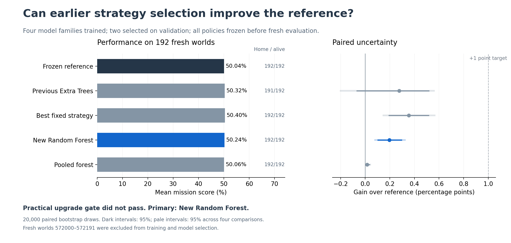

# Modal planner lab — completed results

**New Random Forest was the primary selected model.** On 192 fresh matched worlds it scored **50.2395%**, versus **50.0434%** for the frozen reference: **+0.1961 percentage points**, paired 95% interval **[+0.0996, +0.2986]**.

The predefined fixed-strategy control, `balanced_early`, scored **50.3979%** (+0.3545 pp versus reference, paired 95% interval [+0.1895, +0.5202]), with 192/192 rovers home/alive. Its gain over the previous model was +0.0784 pp, interval [-0.1811, +0.4603].

The predeclared practical-upgrade gate **did not pass**. Criteria not met: gain of at least +1 pp over the reference; mean at least as high as the previous Extra Trees. The canonical reference remains unchanged.

## Fresh comparison

| Policy | Mean score | Gain vs reference | Paired 95% interval (pp) | Home/alive | Deaths |
|---|---:|---:|---:|---:|---:|
| Frozen reference | 50.0434% | +0.0000 pp | [+0.0000, +0.0000] | 192/192 | 0 |
| Previous Extra Trees | 50.3195% | +0.2761 pp | [-0.0708, +0.5206] | 191/192 | 0 |
| Best fixed strategy | 50.3979% | +0.3545 pp | [+0.1895, +0.5202] | 192/192 | 0 |
| New Random Forest | 50.2395% | +0.1961 pp | [+0.0996, +0.2986] | 192/192 | 0 |
| Pooled forest | 50.0593% | +0.0159 pp | [+0.0011, +0.0385] | 192/192 | 0 |

Primary versus the previous frozen Extra Trees: **-0.0801 pp**, paired 95% interval **[-0.3395, +0.2954]**. Against the reference it won on 37 worlds, tied on 147 and lost on 8. Its interval adjusted for four comparisons is **[+0.0741, +0.3289] pp**. All fresh policies had zero controller errors and invalid calls.



[Vector figure](fresh-comparison.svg) · [PDF figure](fresh-comparison.pdf) · [full statistics](final/summary.json) · [independent statistics audit](final/statistics-audit.json)

## What was trained

384 training worlds × 16 strategy programs, 64 validation worlds × 16 programs plus the previous model, and 192 fresh worlds × five policies: **8,192 production missions**. Four model families were actually fitted on Modal in parallel: Extra Trees, Random Forest, a pooled action-conditioned forest with failure prediction, and a two-layer MLP. Each uses 61 public-state features at tick 70. The existing reference handles navigation; the learner chooses a strategy program. No hidden state, map seed or future outcome is a decision input.

Validation tested 24 fixed settings and selected two distinct families. All four original checkpoints are retained. The neural network did not satisfy validation eligibility. The best fixed strategy was `balanced_early`. Selection and weights were published before any fresh mission in commit `49f4736dca40a3e059572ead258b260d06808f8b`.

| Model family, best validation setting (eligible ranked first) | Validation score | Gain vs reference | Home/alive | Eligible |
|---|---:|---:|---:|---|
| extra_trees | 51.6814% | +0.0000 pp | 64/64 | yes |
| mlp | 50.4235% | -1.2579 pp | 63/64 | no |
| pooled_forest | 51.6883% | +0.0069 pp | 64/64 | yes |
| random_forest | 52.0685% | +0.3871 pp | 64/64 | yes |

## Which ideas helped on development worlds

The table below is descriptive validation evidence, used in selection. It is not another fresh confirmation.

| Fixed strategy | Validation score | Gain vs reference | Home/alive | Deaths |
|---|---:|---:|---:|---:|
| aggressive_early | 51.6312% | -0.0502 pp | 63/64 | 1 |
| aggressive_guarded | 36.2295% | -15.4519 pp | 64/64 | 0 |
| aggressive_late | 51.4512% | -0.2302 pp | 63/64 | 1 |
| aggressive_safe300 | 51.7460% | +0.0646 pp | 64/64 | 0 |
| aggressive_safe340 | 51.7818% | +0.1004 pp | 64/64 | 0 |
| arrival_wide | 51.8920% | +0.2106 pp | 64/64 | 0 |
| balanced_early | 51.9379% | +0.2565 pp | 64/64 | 0 |
| baseline | 51.6814% | +0.0000 pp | 64/64 | 0 |
| deadline_focus | 50.5607% | -1.1207 pp | 64/64 | 0 |
| deadline_push | 51.1794% | -0.5020 pp | 64/64 | 0 |
| energy_conservative | 51.3843% | -0.2972 pp | 64/64 | 0 |
| energy_strong | 51.1042% | -0.5772 pp | 63/64 | 1 |
| fast_guarded | 36.0846% | -15.5968 pp | 64/64 | 0 |
| late_value_optimist | 51.4971% | -0.1843 pp | 64/64 | 0 |
| multistart | 51.7109% | +0.0295 pp | 64/64 | 0 |
| refresh | 51.7109% | +0.0295 pp | 64/64 | 0 |

Choosing the best of all 16 outcomes with hindsight would gain only **1.1429 pp** on validation. That is a descriptive ceiling, not an executable policy. The predeclared practical target remained +1 pp. Return guards were overly conservative. The table retains every tested strategy, including both beneficial and unsuccessful variations. [Full diagnostics and paired strategy comparisons](development-diagnostics.json).

## Verification and limits

All **8,226 archived missions** (production plus 34 smoke) replay exactly on Linux. On the Mac, every physical trajectory and grade matches; 641 differ only in decorative map metadata. 8 full controller reruns also match, including the original reference, previous frozen learned policy and selected new learner. All checkpoint predictions, validation rankings, new/old model choices and final paired statistics independently reproduce. Eight controller/model tests and a separate concurrent-report test passed.

[Linux fresh replay audit](final/cloud-audit.json) · [Mac fresh replay audit](final/local-audit.json) · [full-controller repeats](final/repeat-audit.json) · [decision audit](final/decision-audit.json) · [selection audit](selection-audit.json) · [training-data audit](data/cloud-audit.json) · [test output](local-tests.txt) · [concurrency test](archive-tests.txt)

One [cross-platform metadata example](platform-difference-example.json) differs by at most 5.55e-17 in decorative coordinates; its physics and score match exactly.

This is one fit seed per family and one normal-map test distribution. Bootstrap intervals describe variation across worlds, not training seeds. The pooled model’s failure penalty and forest-disagreement penalty are heuristics, not safety guarantees. No new Claude evaluation, reference promotion, simulator change or teammate-model modification occurred.

## Compute and reproduction

Up to 100 mission containers; four model fits in parallel. Recorded mission-worker CPU time totals **67.71 hours**, with shared prefixes. Model fit durations were extra_trees: 1.13 s, mlp: 0.17 s, pooled_forest: 28.92 s, random_forest: 2.92 s. These measurements exclude platform/startup/idle/replay overhead and are not an invoice. No GPU or LLM API calls. [Compute details](compute-summary.json).

Original attempts, platform preemptions, partial checkpoints and every policy outcome are retained. Controller, feature and model definitions stayed pinned. Orchestration and audit code were recorded separately, including fixes for concurrent report writes and audit memory use. Per-attempt hashes preserve those changes. All ten experiment apps are [verified stopped](app-status.json); other apps were left unchanged.

[Protocol](../planner-lab.md) · [selection](selection.json) · [weights](models/) · [fit calls](fit-receipt.json) · [training receipts](data/receipts.jsonl) · [fresh receipts](final/receipts.jsonl) · [figure provenance](figure-receipt.json)

```sh
python -m tools.planner_lab.run summary
python -m tools.planner_lab.verify_selection selection
python -m tools.planner_lab.verify_selection final
python -m tools.planner_lab.audit final decisions
python -m tools.planner_lab.plot
```

The cloud entry points are `tools.planner_lab.run` (`smoke`, `data`, `fit`, `final`) and `tools.planner_lab.audit` (`cloud`, `repeats`). Existing archived stages resume only missing batches. Published selection/weights are immutable; final worlds are now consumed and must not be reused for tuning.
