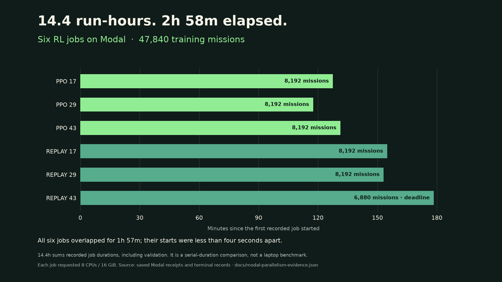

# Lightlag — Codex and Modal prize submission

Prepared Sunday 15 November 2026; public-source access verified at **06:12 Helsinki**. **Sölvi confirms saving both Best Use of Codex and Best Use of Modal in the application.** This is user-confirmed selection, not an independent UI check or confirmation of FINAL submission. This is the team's sponsor case; the detailed [evidence log](prize-evidence.md) retains attribution, failures, app IDs and costs.

**Source access resolved:** at Sölvi's explicit request, the repository is now **PUBLIC**. GitHub metadata confirms public visibility, and anonymous requests to both the [repository](https://github.com/solvisantos22/junction-2026) and [this sponsor case](https://github.com/solvisantos22/junction-2026/blob/main/docs/sponsor-submission.md) returned **HTTP 200** with the expected content. The Modal app is also public. The remaining entry check is the Junction form, not source access.

## Finish the entry

The last authenticated watcher observation, approximately **05:23 Helsinki**, showed Lightlag as **Draft**, with empty selections and material fields. **Sölvi's subsequent confirmation that both prizes are saved supersedes that older selection snapshot.** FINAL status and the current material fields are not independently verified. This session could not access the authenticated browser; it has **not** changed or submitted the form.

One teammate should finish and check the existing [saved Lightlag entry](https://hackjunction.app/participate/45/submissions):

1. Keep **AfterQuery / Break the Agent** as the main challenge and the two already-saved **Codex + Modal** selections. Recheck they persist when reviewing the final entry; do not create another project submission for them.
2. Put the [public Modal app](https://kristjansolvi03--lightlag-traverse-live-web.us-east.modal.run/) in **Project Demo**, the now-public [repository](https://github.com/solvisantos22/junction-2026) in **Source Code**, and [this sponsor case](https://github.com/solvisantos22/junction-2026/blob/main/docs/sponsor-submission.md) in **Other Links** or the description. Use the two paragraphs below in any sponsor-specific fields; if none exist, include their short combined version in the project description. Source and sponsor links have been checked anonymously; check the final video and PDF links the same way.
3. Add the team's final **public video (at most two minutes)** and **PDF deck**. Give each sponsor visible credit in the deck; the short video line below can fit alongside the project's main story. This does not require a second video or a raw conversation dump.
4. Check the current [Codex brief](https://hackjunction.app/participate/45/tech-challenges/49) and [Modal brief](https://hackjunction.app/participate/45/tech-challenges/40) for any additional entry control or updated instruction. No separate prize form was found in the retained briefs or community copies; this is **not** confirmation that no additional step exists.
5. **Submit FINAL before 10:00 Helsinki today**, reopen the entry, and verify its status, both sponsor selections, video, PDF, judge-accessible source and demo links. One teammate can submit for the team. [Organizer updates and sources](junction-event-updates.md) · [presentation checklist](sunday-presentation-plan.md).

**Handoff to the teammate submitting:** record the verified save time, final status, selected tech challenges and judge-access arrangement here or in `TEAM_STATUS.md`. Until that check, distinguish “materials ready” from “entered.” No further experiments are needed.

## Best Use of Codex — copy-ready case

> Sölvi used Codex throughout his development work on Lightlag: turning research ideas into prototypes, implementing controllers and evaluation tools, debugging experiments, and shipping verified increments. The team set the hypotheses, budgets and stopping decisions. Parallel Codex agents implemented and independently reviewed changes; shared task claims and frequent commits kept concurrent work coordinated. Codex helped deliver small reinforcement-learning controllers, Modal orchestration, interruption recovery and reproducible reports, including 2,560 final hybrid evaluations. We also tested the team's frozen environment with three OpenAI models in 18 scored agent runs, retaining configurations, trajectories and rewards. Our case is the complete path from a human research question to implemented software and inspectable experimental evidence, with actual OpenAI agent behavior available for comparison.

Suggested headline: **“Built with Codex. Tested with OpenAI agents.”** In the explanation, give each its precise role: Codex was a development tool; the OpenAI API models were benchmark participants. The short sponsor pitch can focus on Codex without listing every development tool. Detailed ownership remains in the [evidence log](prize-evidence.md#attribution-boundary); this wording does not claim that Codex authored every part of the project or the separate tier-evaluation runner.

Sölvi's 20–25 second spoken version:

> “I used Codex throughout my coding on Lightlag, from prototypes and reinforcement-learning controllers to debugging and verifying experiments. We used parallel agents and small reviewed commits to keep the work reviewable. Then our team tested the environment with three OpenAI models across eighteen scored agent runs. We can show the code, the model behavior and the evidence behind each result.”

### OpenAI evaluation evidence supporting the project

The saved [run ledger](tier-comparison/runs.jsonl), [method](tier-comparison.md) and [tables](tier-comparison/tables.md) record **18 scored OpenAI agent runs**: GPT-6.1 Sol, GPT-6.1 Terra and GPT-6 Luna, three repeats per model on each of two tasks. Nine runs use the three-mission campaign (worlds 2027–2029); nine use the single-mission task (world 2026). All 18 saved model configurations and rewards match the ledger. The agents used **OpenCode 1.19.5 in Harbor 0.25.0** to operate the rover through its tools.

This strengthens the project's evidence of testing with real OpenAI agents. It is separate from evidence of **using Codex to develop software**: the tested agents are not Codex sessions, and their model names do not identify the model behind our development sessions. The tier-evaluation implementation remains credited to its owner in the linked report. Seventeen of the 18 saved runs retain nonzero-exit errors; the verifier still saved their scores. Say “scored runs,” not “18 error-free completions.” Three additional OpenAI one-request program evaluations are a separate set, excluded from the 18 count. No new inference was run for this submission narrative.

Three concrete things to show a Codex judge:

| Story | Delivered proof | Human judgment / limit |
|---|---|---|
| Build a benchmark that can be checked | [Public-tool evaluator fix](https://github.com/solvisantos22/junction-2026/commit/73098c6): invalid requests cannot be swallowed while keeping a valid score; regression tests accompany it. | This is the early Lightlag evaluator, not a claim that Codex authored the final Traverse environment. |
| Coordinate implementation, experiments and independent reviews | [Six-run learning report](learning-final-results/README.md), [shared workflow](../.agents/skills/junction-team-workflow/SKILL.md), [claims and handoffs](../TEAM_STATUS.md). | Sölvi chose priorities, authorized budgets and stopped further experiments. Agent reviews are not human line-by-line review. |
| Ship evidence even when the result is smaller than hoped | [Final result commit](https://github.com/solvisantos22/junction-2026/commit/a79694bc), [source bundle, audits and figure](learning-hybrid-results/final/completed/README.md). | Hybrid 39.31% versus greedy 38.40%; +0.907 percentage points, below our declared one-point target. Reference 51.27% remains. |

If showing a session capture, use an existing genuine project excerpt or label a later walkthrough as a reconstruction. The task summaries in the log are not verbatim prompts. Do not claim an unrecorded Codex model version, percentage of code authored, hours saved, or sole authorship of the repository.

## Best Use of Modal — copy-ready case

> We built Lightlag into a parallel laboratory for finding agent failures and testing whether learning fixes them. Modal powered the whole cycle: generate rover missions, train competing policies, evaluate them on fresh worlds, and let judges explore the results in a live app. Our six RL jobs produced 47,840 training missions: 14.4 hours of recorded run durations overlapped into 2 hours 58 minutes. A separate 1,500-mission comparison contained 10.3 hours of recorded execution time and finished in about seven minutes on up to 100 CPU containers. That capacity let us compare methods and training seeds while teammates built the presentation. Modal Functions ran the jobs, Volumes retained checkpoints and replays, and Dicts tracked progress. Every result stayed tied to its source and weights, including failures. The deployed demo makes the same environment accessible to judges.

### The argument for the prize

**The strongest differentiator is the complete experiment cycle, with both parallel learning and an interactive deployment.** Tie scale to the questions it let the team answer: does a failure recur across worlds, does a controller actually learn, and does its gain survive a fresh comparison? Modal supported repeated, auditable answers within the event's time limit. This is our specific case; we have not surveyed every competitor or established that nobody else built a similar system.

Our small replay learner improved from **8.27% to 36.29%** on 40 fresh worlds, averaged across three initializations. Greedy scored 37.99% and the reference 50.82% on those worlds. The result demonstrates learning on the navigation scaffold; the stronger controls and unequal latest replay budgets remain in the [full result](learning-final-results/README.md). The later hybrid test and its small gain are a separate study.

[1920×1080 PNG for the deck/video](modal-parallelism/training-overlap.png) · [SVG](modal-parallelism/training-overlap.svg) · [Measured data and source hashes](modal-parallelism-evidence.json) · [Offline reproduction script](modal-parallelism/generate.py).

| What we can say | What the comparison measures |
|---|---|
| **Six RL jobs: 14h 22m 36s of recorded run durations within a 2h 58m 27s window.** | Exact saved wrapper starts and returned elapsed durations. All six overlapped for 1h 57m; starts were within 3.90 seconds. Includes validation/bookkeeping, excludes pre-wrapper setup/queue time. Each job requested 8 CPUs / 16 GiB; these are allocations, not measured utilization. |
| **Those durations placed end to end are 4.83× the observed parallel window.** | A same-duration sequential scenario. It is **not a measured laptop speedup**, a CPU-hours total, or proof that all non-Modal infrastructure would take that long. A local multiprocess pool or another cloud could also parallelize work. |
| **1,500 missions: 10.28 hours of summed execution time, about seven minutes for the batch.** | The execution sum comes from the exact original 1,500 rows. The approximately seven-minute batch time and 100-container peak are documented by the farm owner; exact batch timestamps were not retained. Timers exclude startup and final grading. |

For “what would it take without Modal?”, use **“running these six recorded jobs one after another would add up to 14.4 hours at their observed runtimes.”** We did not run a matched laptop benchmark. The benefit we demonstrated is simultaneous work and a ready deployment, with persistent evidence, while the team kept its machines available for development. No fresh training or local timing run is needed for this pitch.

Suggested 25–30 second explanation for a sponsor conversation or live pitch (if used in the video, replace a segment and keep the total within two minutes):

> “Modal powered our learning loop. Six reinforcement-learning jobs ran together: fourteen hours of recorded run time in just under three hours. Our rollout farm handled fifteen hundred missions in about seven minutes. That let us compare training methods, check fresh worlds, and retain every checkpoint and failure while the team kept building. Then we deployed the same environment on Modal so you can explore the rover runs yourself.”

| Modal criterion from the retained brief | Evidence to show |
|---|---|
| **Effective use — 40%** | CPU mission workers, parallel training, persistent artifacts and live serving. [Farm implementation/report](traverse-farm.md), [training receipts and checkpoints](learning-final-results/fit/README.md), [live-app source](../tools/traverse_farm/live_app.py). This is actual infrastructure use, not a logo or credit redemption. |
| **Technical ambition — 25%** | Matched fresh-world comparisons, policy/source freezes, recorded failure recovery, all-seed learning and deterministic replay audits. [Learning report](learning-final-results/README.md), [hybrid final audit](learning-hybrid-results/final/completed/README.md). |
| **Impact — 20%** | Tests whether an apparent failure or improvement transfers beyond one example. The farm records where saved agent programs lose their rovers; the learner shows measurable learning while retaining stronger controls. These are benchmark-development results, not proof of deployment on a real rover. |
| **Live demo — 15%** | [Public Modal URL](https://kristjansolvi03--lightlag-traverse-live-web.us-east.modal.run/). For a quick judge walkthrough use already-cached [campaign world 2027](https://kristjansolvi03--lightlag-traverse-live-web.us-east.modal.run/world/2027). Eight controllers are configured; one slower program can join a newly generated replay later. |

The farm/live app was delivered by **Kristján with Claude Code**. Sölvi's learner/hybrid infrastructure was delivered with **Codex**; Kristján also used Codex for learned planner experiments, and Manh used Claude Code for PPO target learning. All count as the team's Modal use; they are not all Codex-authored work.

Additional completed team evidence: [Manh's target-controller training](../lightlag_ppo_icm/README.md) records four runs of 25,600 missions and reports $14.41 from `modal billing report`; [Kristján's Codex planner lab](planner-lab-results/README.md) records 8,192 production missions and four fitted model families on Modal. Its final Random Forest gained +0.1961 percentage points over the reference on 192 fresh worlds, below its declared upgrade target. These are separate studies, not extra missions from Sölvi's six-run campaign. Use their own accounting boundaries rather than adding a guessed team total.

Useful run references: farm **`ap-gBRd5446NAlbSopK5sdrI4`**, original final learning **`ap-GGkMI4eQi8N9MVVuTef5Au`**, final hybrid **`ap-GzqnjGbRi4h0x0SqO4xiQW`**. The live deployment is **`lightlag-traverse-live`** in Kristján's workspace. Dashboard access may require the owner; the demo and repository reports are public judge-facing evidence.

Use efficiency, not spend, as the argument. The original final training's **$7.2624** and cumulative hybrid's **$6.3471** are separate running CPU/memory estimates with exclusions, not bills or team-wide totals. The latter includes its development/recovery/confirmation/final stages; do not add the final stage again. The separate incomplete greedy-prior study is retained in the log. These small controllers used CPUs; do not describe them as GPU training, Modal Dojo, or LLM fine-tuning. The farm uses isolated Modal function containers; do not claim a `modal.Sandbox` integration without one.

## Short combined copy for the description or deck

> Codex supported implementation, review, debugging and reproducible experiments under human direction. The team also tested its environment with three OpenAI models in 18 scored agent runs. Modal powered parallel rover rollouts, 47,840 missions across six controller-training calls, and our public interactive demo. Our repository links code, checkpoints, app IDs, audits and measured outcomes to their contributors. We have selected Best Use of Codex and Best Use of Modal alongside AfterQuery.

Both selections are now saved according to Sölvi. This does not establish that the overall project is FINAL; retain the final-status check above.

Optional video line (about 12 seconds): **“Codex helped us build and audit the learning pipeline. We tested OpenAI agents, trained controllers in parallel on Modal, and deployed a live demo.”** Put the demo URL and `docs/sponsor-submission.md` on the closing slide. Keep the full video within its two-minute limit; the video owners decide placement.

## Source freshness and checks

- **Official prize requirements:** authenticated [Codex](https://hackjunction.app/participate/45/tech-challenges/49) and [Modal](https://hackjunction.app/participate/45/tech-challenges/40) briefs last directly read **13 November around 22:10 Helsinki**, as recorded in [sponsor research](../SPONSOR_OPTIONS.md). Codex asks for meaningful development use. Modal's retained rubric is shown above; neither retained brief makes a GPU mandatory.
- **Public cross-check today:** [Codex copy](https://junction2026.com/challenges/openai-best-use-of-codex) and [Modal copy](https://junction2026.com/challenges/modal-best-use-of-modal) agree with those core requirements. Their footers explicitly say **community-made**. They are corroboration, not newly authenticated official guidance, and do not establish current form mechanics or saved entry status.
- **Current Junction access limit:** browser host unavailable; native Chrome access not approved, including the retry Sölvi requested; authenticated pages unavailable through web retrieval. No login bypass, Junction form change, external message or prize submission was attempted. The latest saved-entry evidence comes from the dated watcher observation above.
- **Public release, 06:12 Helsinki:** after Sölvi requested public access, GitHub visibility was changed and verified as `PUBLIC` / `isPrivate: false`. Anonymous source and sponsor-page requests returned HTTP 200 with expected content. Before release, Gitleaks 8.30.1 checked Git history and later incoming changes; all 220 historical matches were reviewed as non-secret hashes, benchmark identifiers or OpenCode snapshot IDs. All 8,316 tracked gzip files were fully parsed (13,421 JSON/JSONL records), their string keys/values and contextual assignments scanned, and all 60 source-ZIP text members scanned; five matches were verified source-file hashes. No unresolved credential finding remained. Earlier broad binary scans were stopped and superseded by this completed text/archive check, not counted as passed. No history rewrite, source/weight modification, visibility change to another repository or new experiment occurred.
- **Live demo check, 05:44–05:45 Helsinki:** homepage HTTP 200 (8,094 bytes); `/world/2027/status` returned `ready`; the existing cached replay returned HTTP 200 (3,219,685 bytes), a replay page rather than a waiting page. These were public HTTP reads, not a new rollout or deployment. Browser rendering/interaction was not retested in this session; the owner's earlier live-build and interaction checks are in the [evidence log](prize-evidence.md). Have the presenter open the cached replay once in a normal browser before pitching.
- **Entry versus credits:** claiming participant credits does not select a prize. Codex participant usage credits are distinct from the API-credit prizes. The public brief copies list Codex prizes of $10,000/$5,000/$2,500 in API credits and Modal's winner prize of $2,000 cash plus $3,000 Modal credits; use the authenticated briefs if these change.

This closeout adds presentation and entry guidance only. Frozen sources, weights, results, reference and teammate videos are unchanged; **no further experiments**.
